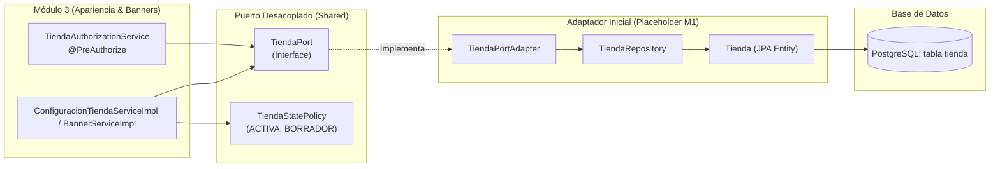

# Arquitectura y Visión General del Backend Nubea

> **Actualización (9 de noviembre de 2026):** este documento conserva una visión histórica y contiene afirmaciones que no reflejan totalmente la implementación actual. En particular, el login no establece sesión, `BannerResponse` expone `storageKey`, las subidas de banners ocurren dentro de métodos transaccionales y la limpieza no tiene cola durable. Para el estado verificado y las prioridades de integración, consultar [flujos del módulo 3](modulo-3-flujos.md), [integración entre módulos](../integracion/modulo-3.md) y [preparación para producción](modulo-3-produccion.md).

Este documento describe la arquitectura, decisiones de diseño, convenciones de desarrollo y estructura técnica del backend de la plataforma **Nubea**. Sirve como referencia arquitectónica para sesiones de desarrollo actuales y futuras.

---

## 1. Pila Tecnológica

| Componente | Tecnología | Versión / Detalle |
| :--- | :--- | :--- |
| **Lenguaje** | Java | 21 (LTS) |
| **Framework Base** | Spring Boot | 4.1.1 (con Spring Security 7, Spring Data JPA, Bean Validation) |
| **Base de Datos** | PostgreSQL | 16+ (probado en contenedor Docker `nubeadb`) |
| **Almacenamiento de Archivos** | S3 Compatible | AWS SDK for Java v2 (`software.amazon.awssdk:s3` v2.29.52) conectado a RustFS local (`localhost:9000`) |
| **Generación de IDs** | UUID Creator | `com.github.f4b6a3:uuid-creator` (soporte para UUID v7) |
| **Criptografía** | Bouncy Castle & Argon2 | `org.bouncycastle:bcprov-jdk18on`, Argon2PasswordEncoder |
| **Productividad** | Project Lombok | `@Getter`, `@Setter`, `@Builder`, `@RequiredArgsConstructor`, etc. |
| **Gestor de Construcción** | Apache Maven | Maven Wrapper (`./mvnw`) |

---

## 2. Convenciones de Diseño y Arquitectura por Capas

El backend adopta un diseño **modular por dominio**, donde cada módulo de negocio vive bajo su propio paquete en `com.ecommerce.backend` y mantiene una estructura de subcapas estandarizada:

```
com.ecommerce.backend.<dominio>/
├── controller/          # Endpoints REST (@RestController), anotaciones @PreAuthorize y códigos HTTP
├── dto/                 # Records inmutables para Request (con Bean Validation) y Response
├── mapper/              # Clases utilitarias finales con métodos estáticos de mapeo entre Entity y DTO
├── service/             # Interfaz del servicio y clase de implementación (@Service, @Transactional)
├── repository/          # Interfaces Spring Data JPA (@Repository)
├── model/               # Entidades JPA mapeadas a las tablas de PostgreSQL
└── event/ & listener/   # Eventos de dominio y listeners asíncronos/transaccionales (si aplica)
```

### Principios Fundamentales:
1. **Inmutabilidad y DTOs Records:** Todas las entradas y salidas de la API pública usan `record` de Java. Las entidades de base de datos nunca se exponen directamente a los controladores ni a los clientes.
2. **Validación Temprana:** Las restricciones de formato se validan en el DTO mediante Bean Validation (`@NotBlank`, `@Size`, `@Min`, etc.). Las reglas funcionales de negocio se validan en la capa `@Service`.
3. **Mapeo Explícito:** Se utilizan clases `Mapper` manuales con constructores privados y métodos estáticos (`toResponse`), garantizando control total de los datos expuestos y evitando filtraciones de campos internos (como claves de almacenamiento S3, contraseñas o datos de auditoría no públicos).
4. **Delimitación Transaccional:** La capa `@Service` maneja `@Transactional`. Las operaciones de solo lectura usan `@Transactional(readOnly = true)`. Las llamadas a servicios externos (S3, proveedores de pago) **nunca** se ejecutan dentro de transacciones abiertas de base de datos.

---

## 3. Modelo de Seguridad y Autorización

### Roles del Sistema
Conforme a la tabla `rol` en el esquema de base de datos (`services/database/init/db.sql`), los roles autorizados son:
* `ADMIN_GENERAL`: Administrador de la plataforma. Gestiona el catálogo global de plantillas, impuestos y vigencias tributarias. No tiene titularidad sobre tiendas ajenas.
* `DUENO_TIENDA`: Vendedor propietario. Dueño de una o más tiendas. Es el único autorizado para administrar la configuración, apariencia, banners y cuenta de cobro de sus tiendas.
* `CLIENTE`: Comprador final de la plataforma.

Estos roles están formalizados en el enum [`RolesUser.java`](file:///home/polux/Desktop/oal/utp/desarrollo-fullstack/nubea/backend/src/main/java/com/ecommerce/backend/enums/RolesUser.java).

### Configuración de Seguridad (`SecurityConfig.java`)
- La clase [`SecurityConfig.java`](file:///home/polux/Desktop/oal/utp/desarrollo-fullstack/nubea/backend/src/main/java/com/ecommerce/backend/config/SecurityConfig.java) tiene activa la anotación `@EnableMethodSecurity`, habilitando el control de acceso declarativo mediante expresiones SpEL en `@PreAuthorize`.
- Se mantiene una política de sesión `STATELESS`.
- Las rutas públicas están restringidas a `/api/auth/**`; cualquier otro endpoint exige autenticación y autorización específica.

### Abstracción de Usuario Autenticado (`CurrentUserProvider`)
Para permitir el desarrollo aislado de los módulos 2 y 3 sin depender de la implementación final de autenticación por cookies/JWT (responsabilidad del Módulo 1), se introdujo la interfaz [`CurrentUserProvider`](file:///home/polux/Desktop/oal/utp/desarrollo-fullstack/nubea/backend/src/main/java/com/ecommerce/backend/shared/security/CurrentUserProvider.java) y su implementación [`SecurityContextCurrentUserProvider`](file:///home/polux/Desktop/oal/utp/desarrollo-fullstack/nubea/backend/src/main/java/com/ecommerce/backend/shared/security/SecurityContextCurrentUserProvider.java):
* Extrae de forma segura el identificador (`UUID`) del usuario autenticado, su correo y evalúa pertenencia a roles.
* Ningún controlador ni servicio recibe el `idUsuario` desde el cuerpo, cabecera o query string de la petición HTTP; siempre se resuelve mediante esta abstracción.

---

## 4. Placeholders y Adaptadores para Integración con Módulo 1

El Módulo 3 administra la apariencia y recursos de una tienda (`{idTienda}`), pero la gestión de creación y ciclo de vida de tiendas pertenece al Módulo 1. Para evitar bloqueos, se implementó el patrón de **Puertos y Adaptadores (Arquitectura Hexagonal)**:



1. **[`TiendaPort`](file:///home/polux/Desktop/oal/utp/desarrollo-fullstack/nubea/backend/src/main/java/com/ecommerce/backend/shared/tienda/TiendaPort.java):**
   Interfaz que expone `Optional<TiendaInfo> obtenerTiendaPorId(UUID idTienda)`. Desacopla por completo la fuente de datos de la tienda.
2. **[`TiendaPortAdapter`](file:///home/polux/Desktop/oal/utp/desarrollo-fullstack/nubea/backend/src/main/java/com/ecommerce/backend/shared/tienda/adapter/TiendaPortAdapter.java):**
   Implementación basada en una entidad mínima [`Tienda.java`](file:///home/polux/Desktop/oal/utp/desarrollo-fullstack/nubea/backend/src/main/java/com/ecommerce/backend/shared/tienda/model/Tienda.java) que consulta la tabla real `tienda` de PostgreSQL. Cuando el Módulo 1 esté completo, solo se reemplaza este adaptador.
3. **[`TiendaAuthorizationService`](file:///home/polux/Desktop/oal/utp/desarrollo-fullstack/nubea/backend/src/main/java/com/ecommerce/backend/shared/security/TiendaAuthorizationService.java):**
   Bean de seguridad utilizado en expresiones SpEL:
   `@PreAuthorize("@tiendaAuthorizationService.esPropietario(#idTienda, authentication)")`.
   Verifica que `tienda.id_propietario == currentUserId`.
4. **[`TiendaStatePolicy`](file:///home/polux/Desktop/oal/utp/desarrollo-fullstack/nubea/backend/src/main/java/com/ecommerce/backend/shared/tienda/policy/TiendaStatePolicy.java):**
   Valida que la tienda permita mutaciones:
   * Estados permitidos para editar apariencia y banners: `ACTIVA`, `BORRADOR`.
   * Estados rechazados: `SUSPENDIDA`, `CERRADA` (arroja `TiendaNoModificableException` -> `409 Conflict`).

---

## 5. Manejo Global de Excepciones y Códigos de Error

[`GlobalExceptionHandler.java`](file:///home/polux/Desktop/oal/utp/desarrollo-fullstack/nubea/backend/src/main/java/com/ecommerce/backend/exception/GlobalExceptionHandler.java) centraliza la traducción de errores a una estructura uniforme [`ErrorResponse`](file:///home/polux/Desktop/oal/utp/desarrollo-fullstack/nubea/backend/src/main/java/com/ecommerce/backend/shared/erros/ErrorResponse.java) `(String codigo, String mensaje)`:

| Estado HTTP | Código Funcional | Excepción Origen | Causa / Descripción |
| :--- | :--- | :--- | :--- |
| **400 BAD REQUEST** | `DATOS_INVALIDOS` | `MethodArgumentNotValidException`, `IllegalArgumentException` | Campos requeridos faltantes, longitud excedida, espacios en blanco. |
| **400 BAD REQUEST** | `ARCHIVO_INVALIDO` | `ArchivoInvalidoException` | Archivo vacío, supera 5MB o formato no soportado (según magic bytes). |
| **400 BAD REQUEST** | `REORDEN_INVALIDO` | `ReordenInvalidoException` | Lista de reordenamiento incompleta, con IDs o valores de orden duplicados. |
| **401 UNAUTHORIZED**| `CREDENCIALES_INVALIDAS` | `CredencialesInvalidasException` | Fallo de autenticación en login. |
| **403 FORBIDDEN** | `ACCESO_DENEGADO` | `AccessDeniedException`, `AuthorizationDeniedException` | Usuario sin rol requerido o intentando acceder a una tienda ajena. |
| **403 FORBIDDEN** | `CUENTA_NO_DISPONIBLE` | `CuentaNoDisponibleException` | Usuario inactivo o suspendido. |
| **404 NOT FOUND** | `PLANTILLA_NO_ENCONTRADA` | `PlantillaNoEncontradaException` | ID de plantilla inexistente o inactiva (para vendedores). |
| **404 NOT FOUND** | `CONFIGURACION_NO_ENCONTRADA` | `ConfiguracionTiendaNoEncontradaException` | Tienda sin configuración visual inicializada (RN-M3-02). |
| **404 NOT FOUND** | `BANNER_NO_ENCONTRADO` | `BannerNoEncontradoException` | Banner inexistente o no perteneciente a la tienda indicada. |
| **409 CONFLICT** | `PLANTILLA_CODIGO_DUPLICADO` | `PlantillaCodigoDuplicadoException` | Código único de plantilla repetido. |
| **409 CONFLICT** | `PLANTILLA_INACTIVA` | `PlantillaInactivaException` | Intento de seleccionar una plantilla inactiva en una tienda. |
| **409 CONFLICT** | `TIENDA_NO_MODIFICABLE` | `TiendaNoModificableException` | Modificación intentada sobre tienda `SUSPENDIDA` o `CERRADA`. |
| **409 CONFLICT** | `USUARIO_YA_EXISTE` | `UsuarioYaExisteException` | Correo electrónico ya registrado. |
| **502 BAD GATEWAY** | `ERROR_ALMACENAMIENTO` | `StorageException` | Error de conexión o fallo del servicio S3 externo. |

> [!IMPORTANT]
> Ninguna respuesta expone trazas de SQL, nombres de restricciones internas de PostgreSQL, credenciales ni stack traces.

---

## 6. Almacenamiento S3 Compatible (RustFS)

Para la carga de banners y recursos multimedia, el proyecto utiliza un servicio compatible con Amazon S3:

* **Servicio Local:** RustFS ejecutándose en Docker (`services/storage/docker-compose.yaml`).
* **Endpoint:** `http://localhost:9000`
* **Bucket:** `nubea`
* **Credenciales:** `nubea_admin` / `nubea_secret`
* **Región:** `us-east-1`
* **Puerto y Adaptador:** [`BannerStoragePort`](file:///home/polux/Desktop/oal/utp/desarrollo-fullstack/nubea/backend/src/main/java/com/ecommerce/backend/shared/storage/BannerStoragePort.java) con implementación [`S3BannerStorageAdapter`](file:///home/polux/Desktop/oal/utp/desarrollo-fullstack/nubea/backend/src/main/java/com/ecommerce/backend/shared/storage/S3BannerStorageAdapter.java).
* **Validación de Imágenes:** [`ImagenValidator`](file:///home/polux/Desktop/oal/utp/desarrollo-fullstack/nubea/backend/src/main/java/com/ecommerce/backend/shared/storage/ImagenValidator.java) analiza los primeros bytes binarios (*magic bytes*) para garantizar que solo se acepten imágenes válidas (`image/jpeg`, `image/png`, `image/webp`, `image/gif`), ignorando cabeceras `Content-Type` falsificadas.
* **Limpieza Asíncrona Post-Commit:** Se utiliza [`BannerStorageCleanupListener`](file:///home/polux/Desktop/oal/utp/desarrollo-fullstack/nubea/backend/src/main/java/com/ecommerce/backend/banner/listener/BannerStorageCleanupListener.java) con `@TransactionalEventListener(phase = AFTER_COMMIT)`. El borrado de objetos en S3 nunca ocurre dentro de la transacción de base de datos; si la limpieza remota falla, se genera un log de advertencia y no se revierte la base de datos.

---

## 7. Guía Práctica para Desarrolladores

### Variables de Entorno y Requisitos
Para compilar y ejecutar el backend en entornos Linux/WSL donde el JDK no esté en el PATH global:
```bash
export JAVA_HOME=/home/polux/.jdks/ms-21.0.13.0.2
export PATH=$JAVA_HOME/bin:$PATH
```

### Contenedores de Soporte Requeridos
Asegurarse de que los contenedores de PostgreSQL y RustFS estén activos:
```bash
# Base de datos PostgreSQL (puerto 5432)
docker compose -f services/database/docker-compose.yaml up -d

# Almacenamiento S3 RustFS (puertos 9000 y 9001)
docker compose -f services/storage/docker-compose.yaml up -d
```

### Comandos de Compilación y Verificación
```bash
cd backend

# Compilar proyecto sin pruebas
./mvnw clean compile

# Resolver dependencias
./mvnw dependency:resolve
```
